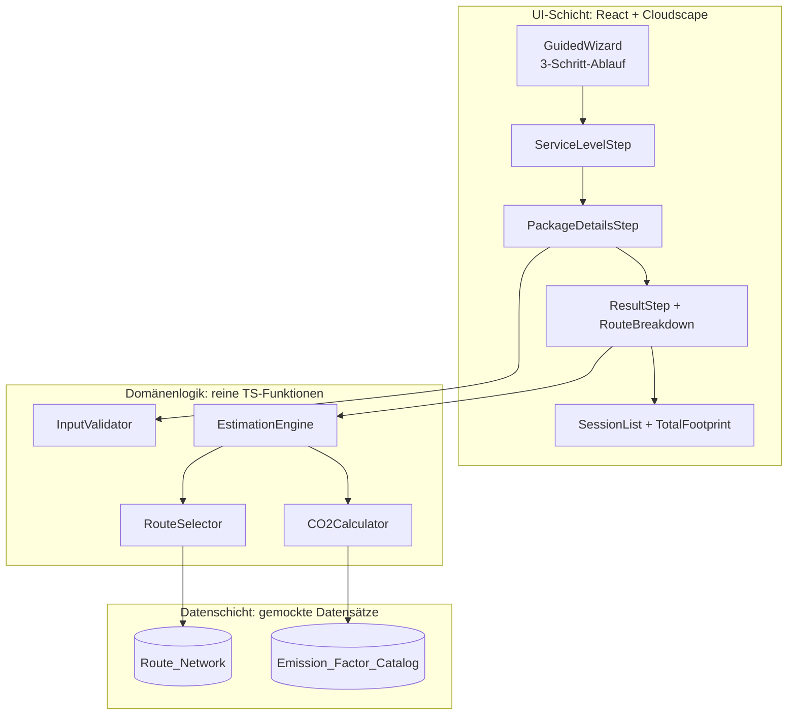
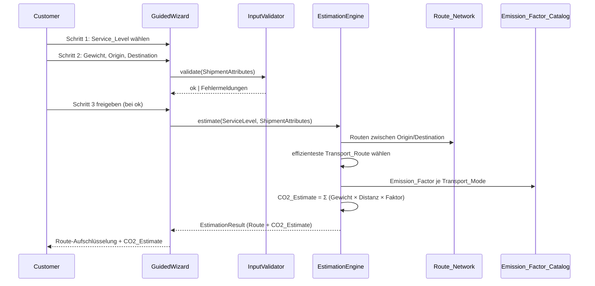

# Design Document

## Overview

Diese Funktion ist ein clientseitiger Prototyp, der einer Customer den CO2-Fussabdruck des Paketversands der Schweizerischen Post schätzt. Die Customer durchläuft einen geführten Dreischritt-Ablauf (Service_Level wählen → Paketdetails eingeben → Route und CO2_Estimate ansehen), fügt mehrere Package-Elemente zu einer Sitzungsliste hinzu und sieht einen Total_Footprint.

Der Kern ist die Estimation_Engine: Sie ermittelt aus einem gemockten Route_Network die effizienteste Transport_Route und berechnet den CO2_Estimate als Summe über alle Route_Segment-Elemente von (Paketgewicht × Segment-Distanz × Emission_Factor der Transport_Mode).

**Technische Eckpunkte und Designentscheide:**

- **Reine Prototyp-Anwendung ohne Backend.** Alle Daten (Route_Network, Emission_Factor_Catalog) sind als statische, gemockte TypeScript-Datensätze im Browser verfügbar. Das vermeidet Infrastruktur und hält den Prototyp lauffähig ohne externe Systeme. Begründung: Produktrichtlinie erlaubt Mocking; die Requirements verlangen ausdrücklich gemockte Daten.
- **UI mit React + Cloudscape Design System** (Coding-Guideline: Web-Anwendungen nutzen Cloudscape, UI in TS). Der geführte Ablauf nutzt die Cloudscape-`Wizard`-Komponente, die Schrittnummer, Gesamtzahl und Navigation nativ unterstützt (Requirement 7).
- **Trennung von reiner Logik und UI.** Die Estimation_Engine und die Validierung sind seiteneffektfreie TypeScript-Funktionen ohne React-Abhängigkeit. Das macht sie direkt mit Property-Based-Tests prüfbar (Requirements 3 und 4) und entkoppelt sie von der Darstellung.
- **Sitzungszustand im Speicher.** Die Sitzungsliste lebt im React-State für die Dauer der Sitzung; keine Persistenz nötig, da die Requirements nur eine Sitzung (max. 50 Package-Elemente) fordern.

Die Schätzungen sind indikative Prototyp-Werte und keine zertifizierten CO2-Bilanzen; dieser Hinweis wird in der UI bei jedem CO2_Estimate und Total_Footprint angezeigt (Requirement 6.2).

## Architecture

Die Anwendung gliedert sich in drei Schichten: eine **UI-Schicht** (React/Cloudscape), eine **Domänenlogik-Schicht** (reine Funktionen: Estimation_Engine, Validierung) und eine **Datenschicht** (gemockte statische Datensätze). Die UI-Schicht ruft die Domänenlogik auf; die Domänenlogik liest aus der Datenschicht. Es gibt keine umgekehrten Abhängigkeiten.



**Ablauf einer Schätzung (Requirements 1–4, 7):**



**Schichtentrennung – Begründung:** Durch die Isolation der Estimation_Engine von React können die anspruchsvollsten Requirements (Routenwahl 3.1–3.6, Summenformel 4.2) ohne UI-Rendering mit vielen generierten Eingaben property-basiert getestet werden.

## Components and Interfaces

### Domänenlogik (reine Funktionen)

#### InputValidator

Validiert die Shipment_Attribute-Eingaben vor der Schätzung (Requirements 2, 4.5).

```typescript
interface ValidationError {
  field: 'serviceLevel' | 'weightGrams' | 'origin' | 'destination';
  messageKey: string; // Schlüssel für lokalisierte Meldung
}

// Prüft Gewicht (numerisch, 1..30000), Origin/Destination gesetzt.
function validateShipment(input: ShipmentInput): ValidationResult;

interface ValidationResult {
  valid: boolean;
  errors: ValidationError[];
  // Bei valid === true: normalisierte, typisierte Attribute
  attributes?: ShipmentAttributes;
}
```

#### EstimationEngine

Orchestriert Routenwahl und CO2-Berechnung (Requirements 3, 4).

```typescript
function estimate(
  serviceLevel: ServiceLevel,
  attributes: ShipmentAttributes,
  network: RouteNetwork,
  catalog: EmissionFactorCatalog,
): EstimationResult;

type EstimationResult =
  | { kind: 'ok'; route: TransportRoute; co2EstimateGrams: number }
  | { kind: 'no-route' }              // Requirement 3.7
  | { kind: 'missing-factor'; mode: TransportMode }; // Requirement 4.4
```

#### ServiceLevelComparison

Stellt für denselben Shipment_Attribute-Satz den CO2_Estimate je Service_Level gegenüber (Requirement 8). Reine Funktion; ruft `estimate` je Service_Level auf und markiert das günstigste `ok`-Ergebnis. Keine eigene Routen- oder CO2-Logik.

```typescript
interface ServiceLevelComparisonRow {
  serviceLevel: ServiceLevel;
  result: EstimationResult;
  isLowest: boolean; // true nur fuer das guenstigste 'ok'-Ergebnis
}

function compareServiceLevels(
  attributes: ShipmentAttributes,
): ServiceLevelComparisonRow[];
```

#### RouteSelector

Ermittelt die Transport_Route gemäss Service_Level-Regeln (Requirements 3.1–3.6).

```typescript
// Liefert alle zulässigen Routen zwischen Origin und Destination,
// jeweils als geordnete Segmentfolge Aufgabe → Eingang → Hauptlauf → Ausgang → Zustellung.
function selectRoute(
  serviceLevel: ServiceLevel,
  origin: RegionId,
  destination: RegionId,
  network: RouteNetwork,
  catalog: EmissionFactorCatalog,
): TransportRoute | null;
```

Auswahlregeln:
- **Kurier** → Pkw-Direktfahrt (Transport_Mode `Car`) zwischen Origin und Destination, ohne Parcel_Center-Hauptlauf (Requirement 3.4). Die Route besteht aus einem einzigen Segment.
- **Priority** → bevorzugt für den Hauptlauf die Transport_Mode `Lkw` (schnelle Strassenzustellung), sofern das Route_Network diese Verbindung mit `Lkw` anbietet (Requirement 3.5).
- **Economy** → bevorzugt für den Hauptlauf die Transport_Mode `Rail`, sofern das Route_Network diese Verbindung mit `Rail` anbietet (Requirement 3.6).
- In allen Fällen wird letztlich die Transport_Route mit der geringsten CO2-Gesamtemission zurückgegeben (Requirement 3.1); die Service_Level-Regeln steuern, welche Kandidaten bevorzugt bzw. gebildet werden.

#### CO2Calculator

```typescript
// Σ über alle Segmente: Gewicht[g] × Distanz[km] × Emission_Factor der Transport_Mode.
// Emission_Factor ist in g CO2e je Tonnen-km; die Einheitenumrechnung
// (Gramm → Tonnen) ist Teil der Berechnung.
function computeCo2Grams(
  weightGrams: number,
  route: TransportRoute,
  catalog: EmissionFactorCatalog,
): number;

// Kaufmännische Rundung, 0,5 wird aufgerundet (Requirement 4.3).
function roundToGram(grams: number): number;
```

### UI-Komponenten (React + Cloudscape)

| Komponente | Verantwortung | Requirements |
|---|---|---|
| `App` | Hält Sitzungszustand (Package-Liste), reicht Callbacks durch | 5 |
| `GuidedWizard` | Cloudscape `Wizard`; Schrittfolge, Fortschritt, Navigationssperren | 7.1–7.6 |
| `ServiceLevelStep` | Drei Optionen (Economy, Priority, Kurier), keine Vorauswahl | 1.1–1.4 |
| `PackageDetailsStep` | Gewicht, Origin, Destination; Inline-Validierungsmeldungen | 2.1–2.7 |
| `ResultStep` | Zeigt Transport_Route-Aufschlüsselung und CO2_Estimate, „Package hinzufügen" | 3, 4, 6 |
| `RouteBreakdown` | Je Route_Segment: Transport_Mode, Distanz, angewandter Emission_Factor + Einheit | 6.1 |
| `SessionList` | Liste der Package-Elemente mit Details + „Entfernen" | 5.1–5.3, 5.5 |
| `TotalFootprint` | Summe aller CO2_Estimate-Werte; 0 bei leerer Liste | 5.4, 5.6 |
| `AssumptionsNote` | Prototyp-/Datenherkunft-Hinweis bei jedem Estimate und Total | 6.2, 6.3 |
| `ServiceLevelComparison` | Stellt je Service_Level CO2_Estimate und Route gegenüber, hebt den geringsten hervor, Auswahl zum Hinzufügen | 8.1-8.5 |

**Begründung Cloudscape `Wizard`:** Die Komponente erfüllt Requirement 7.2 (Schrittnummer, Gesamtzahl, verbleibende Schritte) und 7.3/7.4/7.6 (Freigabe/Sperre von Übergängen) direkt, ohne eigene Navigationslogik.

## Data Models

### Domänentypen

```typescript
type ServiceLevel = 'Economy' | 'Priority' | 'Kurier';
type TransportMode = 'Lkw' | 'Rail' | 'E_Trike' | 'Car';
type RegionId = string;        // Herkunfts-/Zielgebiet, z. B. 'bern', 'tessin'
type CenterId = string;        // Parcel_Center, z. B. 'haerkingen'
type SegmentRole = 'Aufgabe' | 'EingangsZentrum' | 'Hauptlauf' | 'AusgangsZentrum' | 'Zustellung';

interface ShipmentAttributes {
  weightGrams: number;         // 1..30000 (nach Validierung)
  origin: RegionId;
  destination: RegionId;
}

interface RouteSegment {
  role: SegmentRole;
  fromId: string;              // Region- oder Center-ID
  toId: string;
  distanceKm: number;          // > 0, aus Route_Network
  mode: TransportMode;
}

interface TransportRoute {
  segments: RouteSegment[];    // geordnet; Reihenfolge gemäss Requirement 3.2
}

interface Package {
  id: string;
  serviceLevel: ServiceLevel;
  attributes: ShipmentAttributes;
  route: TransportRoute;
  co2EstimateGrams: number;    // gerundet (Requirement 4.3)
}
```

### Parcel_Center (gemocktes Netz)

Standorte beruhen auf öffentlich recherchierten realen Standorten der Schweizerischen Post; Distanzen sind gemockt (Requirement 6.3).

```typescript
interface ParcelCenter {
  id: CenterId;
  name: string;
  tier: 'national' | 'regional';
}
```

| id | name | tier |
|---|---|---|
| `haerkingen` | Härkingen | national |
| `daillens` | Daillens | national |
| `frauenfeld` | Frauenfeld | national |
| `ostermundigen` | Ostermundigen | regional |
| `cadenazzo` | Cadenazzo | regional |

### Region → Eingangs-/Ausgangs-Parcel_Center

Jedes Herkunfts-/Zielgebiet wird genau einem Parcel_Center zugeordnet (Requirements 2.4, 2.5). Das Aufgabe-Segment führt von der Region zum zugeordneten Eingangs-Zentrum, das Zustellung-Segment vom Ausgangs-Zentrum zur Zielregion.

```typescript
interface Region {
  id: RegionId;
  name: string;
  centerId: CenterId;          // zugeordnetes Parcel_Center
  accessDistanceKm: number;    // Distanz Region ↔ Zentrum (gemockt)
  accessMode: TransportMode;   // i. d. R. 'Lkw' bzw. 'E_Trike' für Zustellung
}
```

| id | name | centerId | accessDistanceKm | accessMode |
|---|---|---|---|---|
| `bern` | Bern | ostermundigen | 8 | E_Trike |
| `mittelland` | Mittelland | haerkingen | 15 | Lkw |
| `waadt` | Waadt | daillens | 12 | Lkw |
| `ostschweiz` | Ostschweiz | frauenfeld | 10 | Lkw |
| `tessin` | Tessin | cadenazzo | 9 | E_Trike |

### Route_Network: Verbindungen (Hauptlauf zwischen Parcel_Center)

Jede Verbindung ist bidirektional und listet die verfügbaren Transport_Mode-Werte mit gemockter Distanz (Requirement 3.3, 3.6). Nicht aufgeführte Paare haben keine direkte Verbindung; fehlt eine Route komplett, greift Requirement 3.7.

```typescript
interface NetworkLink {
  a: CenterId;
  b: CenterId;
  distanceKm: number;
  modes: TransportMode[];      // z. B. ['Lkw', 'Rail']
}
```

| a | b | distanceKm | modes |
|---|---|---|---|
| `haerkingen` | `daillens` | 95 | Lkw, Rail |
| `haerkingen` | `frauenfeld` | 110 | Lkw, Rail |
| `haerkingen` | `ostermundigen` | 55 | Lkw, Rail |
| `haerkingen` | `cadenazzo` | 150 | Lkw |
| `daillens` | `ostermundigen` | 85 | Lkw, Rail |
| `frauenfeld` | `cadenazzo` | 220 | Lkw |
| `daillens` | `frauenfeld` | 200 | Lkw |
| `daillens` | `cadenazzo` | 210 | Lkw, Rail |

Hinweis: Der Hauptlauf kann aus einem oder mehreren verketteten `NetworkLink`-Elementen bestehen; der RouteSelector sucht Pfade im Netz. Für den Prototyp ist das Netz klein genug, dass eine einfache erschöpfende Pfadsuche (keine Zyklen) genügt. Begründung Simplicity: kein Dijkstra-Framework nötig bei wenigen Knoten.

Begruendung Service_Level-Divergenz: Die Unterscheidung von Economy und Priority entsteht in der Routing-Logik (modesForLink), nicht in einzelnen Datenwerten: Economy bevorzugt im Hauptlauf `Rail`, Priority bevorzugt `Lkw` (Strasse). Bietet ein Hauptlauf-Link beide Modi an, waehlen die beiden Service_Level damit verschiedene Transport_Mode-Werte und erhalten unterschiedliche CO2_Estimate-Werte (Requirement 8). Das ist robust gegenueber Aenderungen der gemockten Distanzen.

### Emission_Factor_Catalog (gemockt)

Werte in Gramm CO2-Äquivalent je Tonnen-Kilometer (g CO2e/t·km) (Requirements 4.2, 6.1).

```typescript
type EmissionFactorCatalog = Record<TransportMode, number>;
```

| Transport_Mode | Emission_Factor (g CO2e/t·km) |
|---|---|
| `Rail` | 15 |
| `Lkw` | 95 |
| `E_Trike` | 5 |
| `Car` | 170 |

**Einheiten-Begründung:** Emission_Factor ist pro Tonnen-km definiert, Paketgewicht liegt in Gramm vor. Die Berechnung rechnet Gramm in Tonnen um (`weightGrams / 1_000_000` ergibt t·km-Beitrag je km·g, bzw. `weightGrams/1000 × distanceKm × factor / 1000`). Entscheidend ist, dass die Formel exakt der Summenregel aus Requirement 4.2 folgt.

## Correctness Properties

*Eine Property ist eine Eigenschaft oder ein Verhalten, das über alle gültigen Ausführungen eines Systems hinweg gelten soll – im Kern eine formale Aussage darüber, was das System tun soll. Properties bilden die Brücke zwischen menschenlesbarer Spezifikation und maschinell prüfbaren Korrektheitsgarantien.*

Die Properties beziehen sich auf die reinen Funktionen der Domänenlogik (Estimation_Engine, Validator, Aggregation) und auf eingabeunabhängige Zustands-/Renderinvarianten. Reine UI-Darstellungsregeln (z. B. feste Hinweistexte, Schrittreihenfolge) werden über Beispiel-/Snapshot-Tests abgedeckt und erscheinen hier nicht.

### Property 1: Routenwahl minimiert die CO2-Gesamtemission

*Für alle* gültigen Kombinationen aus Service_Level, Paketgewicht (1..30000 g), Origin und Destination, für die das Route_Network mindestens eine Transport_Route liefert, gilt: Der CO2_Estimate der gewählten Transport_Route ist kleiner oder gleich dem CO2_Estimate jeder anderen zulässigen Kandidatenroute für dieselbe Eingabe.

**Validates: Requirements 3.1**

### Property 2: Routenstruktur-Invariante inklusive Kurier-Direktfahrt

*Für alle* erzeugten Transport_Route-Elemente gilt: Bei Service_Level Kurier besteht die Route aus genau einem Route_Segment mit Transport_Mode Car, das direkt von Origin zu Destination führt; bei Economy und Priority folgen die Route_Segment-Rollen der festen Reihenfolge Aufgabe, EingangsZentrum, Hauptlauf (ein oder mehrere Segmente), AusgangsZentrum, Zustellung.

**Validates: Requirements 3.2, 3.4**

### Property 3: Segment-Invariante für Distanz und Transport_Mode

*Für alle* Route_Segment-Elemente jeder erzeugten Transport_Route gilt: Das Segment hat genau eine Distanz grösser 0 Kilometer und genau eine Transport_Mode, die für die entsprechende Verbindung im Route_Network (bzw. für den Region-Zugang) verfügbar ist.

**Validates: Requirements 3.3**

### Property 4: Priority nutzt Lkw, wenn verfügbar

*Für alle* Origin/Destination-Paare mit Service_Level Priority, für die jede Verbindung des gewählten Hauptlaufs im Route_Network die Transport_Mode Lkw anbietet, gilt: Alle Hauptlauf-Segmente der gewählten Route haben die Transport_Mode Lkw.

**Validates: Requirements 3.5**

### Property 5: Economy nutzt Rail, wenn verfügbar

*Für alle* Origin/Destination-Paare mit Service_Level Economy, für die jede Verbindung des gewählten Hauptlaufs im Route_Network die Transport_Mode Rail anbietet, gilt: Alle Hauptlauf-Segmente der gewählten Route haben die Transport_Mode Rail.

**Validates: Requirements 3.6**

### Property 6: CO2_Estimate entspricht der Summenformel

*Für alle* Paketgewichte (1..30000 g) und alle Transport_Route-Elemente mit vollständigem Emission_Factor_Catalog gilt: Der berechnete CO2_Estimate ist gleich der Summe über alle Route_Segment-Elemente des Produkts aus Paketgewicht, Segment-Distanz in Kilometern und dem Emission_Factor der jeweiligen Transport_Mode (mit konsistenter Einheitenumrechnung).

**Validates: Requirements 4.2**

### Property 7: CO2_Estimate ist linear im Paketgewicht

*Für alle* Transport_Route-Elemente und alle positiven Faktoren k, für die auch k × Paketgewicht im gültigen Bereich liegt, gilt: Der ungerundete CO2_Estimate für k × Paketgewicht ist gleich k × dem ungerundeten CO2_Estimate für das ursprüngliche Paketgewicht.

**Validates: Requirements 4.2**

### Property 8: Rundung auf das nächste ganze Gramm

*Für alle* nichtnegativen reellen CO2-Werte gilt: Das gerundete Ergebnis ist ganzzahlig, weicht um höchstens 0,5 Gramm vom Ausgangswert ab, und ein Bruchteil von genau 0,5 Gramm wird aufgerundet.

**Validates: Requirements 4.3**

### Property 9: Ungültiges Paketgewicht wird abgelehnt

*Für alle* Eingaben, deren Paketgewicht kleiner als 1 g, grösser als 30000 g, fehlend oder nicht-numerisch ist, gilt: Die Validierung liefert ein ungültiges Ergebnis mit einem auf das Paketgewicht bezogenen Fehler, und die Estimation_Engine berechnet keinen CO2_Estimate.

**Validates: Requirements 2.2, 2.3, 4.5**

### Property 10: Gültiger Shipment_Attribute-Satz wird angenommen

*Für alle* Eingaben mit einem Paketgewicht im Bereich 1..30000 g, genau einem gültigen Origin und genau einer gültigen Destination aus dem Route_Network gilt: Die Validierung liefert ein gültiges Ergebnis mit normalisierten Shipment_Attribute-Werten, die der Eingabe entsprechen.

**Validates: Requirements 2.7**

### Property 11: Total_Footprint ist die Summe der aktuellen Package-Elemente

*Für alle* Folgen von Hinzufüge- und Entfernen-Operationen auf der Sitzungsliste (bis maximal 50 Elemente) gilt: Der angezeigte Total_Footprint ist gleich der Summe der CO2_Estimate-Werte aller aktuell in der Liste enthaltenen Package-Elemente; bei leerer Liste ist der Total_Footprint 0.

**Validates: Requirements 5.1, 5.4, 5.5, 5.6**

### Property 12: Eingaben bleiben über Navigation und Service_Level-Wechsel erhalten

*Für alle* eingegebenen Shipment_Attribute-Werte gilt: Ein Wechsel des Service_Level oder eine Rückkehr zu einem vorherigen Schritt lässt die zuvor eingegebenen Werte unverändert.

**Validates: Requirements 1.3, 7.5**

### Property 13: Route-Aufschlüsselung zeigt je Segment Transport_Mode, Distanz und Emission_Factor

*Für alle* Transport_Route-Elemente gilt: Die erzeugte Route-Aufschlüsselung enthält für jedes Route_Segment die Transport_Mode, die Distanz in Kilometern sowie den angewandten Emission_Factor mit seiner Masseinheit.

**Validates: Requirements 6.1**

## Error Handling

Fehler werden als typisierte Rückgabewerte modelliert (keine Exceptions in der Domänenlogik), damit die UI gezielt reagieren und Eingaben erhalten kann.

| Fehlerfall | Erkennung | Verhalten | Requirements |
|---|---|---|---|
| Kein Service_Level gewählt | UI-Gate vor Schritt 2 | Übergang blockiert, Meldung „Service-Level wählen", Eingaben bleiben | 1.4 |
| Gewicht ausserhalb 1..30000 g | `validateShipment` | Ablehnung, Meldung mit zulässigem Bereich, Eingaben bleiben | 2.2, 4.5 |
| Nicht-numerisches Gewicht | `validateShipment` | Ablehnung, Meldung „numerischer Wert", Eingaben bleiben | 2.3, 4.5 |
| Leeres/fehlendes Gewicht | `validateShipment` | Ablehnung, Meldung „Paketgewicht verlangt", Eingaben bleiben | 2.6 |
| Keine Route Origin↔Destination | `estimate` → `no-route` | Meldung „keine Route verfügbar", Shipment_Attribute bleiben | 3.7 |
| Fehlender Emission_Factor | `estimate` → `missing-factor` | Meldung „keine Schätzung für Transportart", Shipment_Attribute bleiben; übrige CO2_Estimate-Werte bleiben sichtbar | 4.4, 6.4 |
| Sitzungsliste voll (50) | `addPackage` | Ablehnung, Liste unverändert, Meldung „Höchstzahl erreicht" | 5.2 |
| Navigation über Fortschritt hinaus | Wizard-Gate | Navigation blockiert, bleibt auf aktuellem Schritt | 7.6 |
| Ungültige Eingaben bei Schrittübergang | Wizard + `validateShipment` | Übergang blockiert, Meldung mit zu korrigierenden Feldern, Werte bleiben | 7.4 |

**Grundprinzip:** Validierung und Engine lehnen ungültige Eingaben ab, ohne den eingegebenen Zustand zu verwerfen. Die UI zeigt Meldungen über Cloudscape-`FormField`-Fehlertexte bzw. `Flashbar`-Hinweise und hält die Customer auf der aktuellen Ansicht.

## Testing Strategy

**Dualer Testansatz.** Property-Based-Tests prüfen die universellen Eigenschaften der Domänenlogik; Unit-/Beispiel- und Snapshot-Tests prüfen konkrete UI-Darstellung, Navigationsgatter und Edge-/Fehlerfälle.

**Warum PBT hier passt:** Estimation_Engine, Validator, CO2Calculator und die Total-Aggregation sind reine Funktionen mit klarem Ein-/Ausgabeverhalten und grossem Eingaberaum (Gewichte, Origin/Destination-Paare, Listenoperationen). Für sie lassen sich „für alle Eingaben X gilt P(X)"-Aussagen bilden (siehe Correctness Properties).

**Warum manche Teile nicht PBT nutzen:** Feste UI-Hinweistexte (6.2, 6.3), die Schrittreihenfolge (7.1) und die Zeitgrenzen (4.1 ≤ 2 s, 5.5 ≤ 1 s) variieren nicht sinnvoll mit Eingaben. Sie werden mit Beispiel-/Snapshot-Tests bzw. einem einfachen Zeitmesstest (Smoke) geprüft.

**Property-Test-Konfiguration:**
- Bibliothek: **fast-check** (etablierte PBT-Bibliothek für TypeScript; nicht selbst implementiert).
- Mindestens **100 Iterationen** je Property-Test.
- Jeder Property-Test referenziert seine Design-Property per Kommentar-Tag im Format:
  `// Feature: swiss-post-co2-footprint, Property {Nummer}: {Property-Text}`
- Jede Correctness Property wird durch **genau einen** Property-Test implementiert.
- Generatoren: Service_Level aus {Economy, Priority, Kurier}; RegionId aus den Route_Network-Regionen; Gewicht als Integer in 1..30000 (für Negativfälle zusätzlich Werte <1, >30000, nicht-numerische Strings, fehlende Werte); Listenoperationsfolgen für die Total-Property.

**Zuordnung Property → Test:**

| Property | Testgegenstand |
|---|---|
| P1 | `selectRoute`/`estimate`: gewählte Route hat minimales CO2 unter allen Kandidaten |
| P2 | Routenstruktur je Service_Level inkl. Kurier-Einzelsegment |
| P3 | Segment-Distanz > 0 und Mode im Netz verfügbar |
| P4 | Priority: minimale Hauptlauf-Distanz |
| P5 | Economy: Rail im Hauptlauf, wenn Netz Rail bietet |
| P6 | `computeCo2Grams` gegen unabhängige Referenzsumme |
| P7 | Linearität im Gewicht |
| P8 | `roundToGram`-Semantik (0,5 aufwärts, Ganzzahl, |diff| ≤ 0,5) |
| P9 | `validateShipment`/`estimate` lehnen ungültige Gewichte ab |
| P10 | `validateShipment` akzeptiert gültige Sätze |
| P11 | Total == Summe nach beliebigen add/remove-Folgen; leere Liste → 0 |
| P12 | Zustandspersistenz bei Service_Level-Wechsel und Zurück-Navigation |
| P13 | `RouteBreakdown`-Ausgabe enthält je Segment Mode, Distanz, Faktor, Einheit |

**Beispiel-, Snapshot- und Smoke-Tests (nicht PBT):**
- Service_Level-Schritt: genau drei Optionen, keine Vorauswahl (1.1); nur gültige Attribute sichtbar (1.2); Fortfahren ohne Auswahl blockiert (1.4).
- Origin/Destination-Auswahl zeigt genau die Route_Network-Regionen (2.4, 2.5); leeres/fehlendes Gewicht (2.6).
- Edge-Cases der Engine: `no-route` bei konstruiertem Teilnetz (3.7); `missing-factor` bei unvollständigem Katalog (4.4, 6.4).
- Sitzungsliste genau bei 50 Elementen (5.2); Package-Darstellung mit allen Feldern (5.3).
- Prototyp-/Datenherkunft-Hinweise (6.2, 6.3).
- Wizard: Schrittreihenfolge und Fortschrittsanzeige (7.1, 7.2); Freigabe/Sperre von Übergängen (7.3, 7.4, 7.6).
- Smoke/Zeit: eine repräsentative Berechnung ≤ 2 s (4.1); Total-Neuberechnung nach Entfernen ≤ 1 s (5.5).

**Verifikationsgate (Coding-Guideline):** Vor Abschluss jeder Implementierungsaufgabe werden statische Analyse (TypeScript-Compiler, ESLint) und die vorhandenen Tests ausgeführt; Property-Tests müssen mit mindestens 100 Iterationen grün sein.


